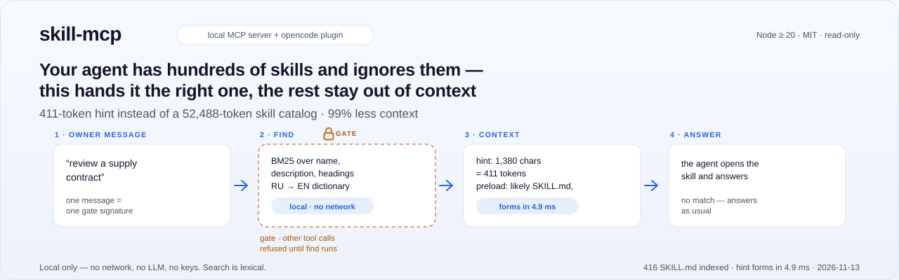
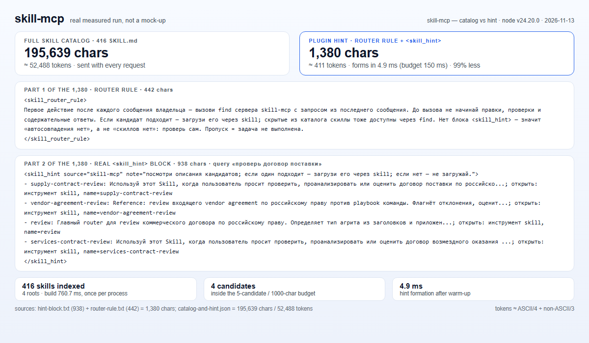

<picture>
 <source media="(prefers-color-scheme: dark)" srcset="assets/gitshow/banner-dark.svg">
 
</picture>

# skill-mcp

[English](README.md) · **Русский**

У вашего агента сотни скиллов, и он их игнорирует — этот инструмент подаёт нужный, а остальные остаются вне контекста.

[](LICENSE)
[](https://nodejs.org)
[](package.json)

Локальный MCP-сервер и плагин для opencode. Он индексирует файлы `SKILL.md`, которые уже лежат на вашей машине, ищет по ним, когда приходит сообщение, и кладёт кандидатов вместе с вероятным совпадением в контекст запроса. Без сети, без ключей API и без собственной модели.

Задача, которую он решает: на каждом шаге модели opencode перечисляет все зарегистрированные скиллы как id, название и описание, и ничего больше (раздел Loading в официальном руководстве по скиллам). Скилл, описание которого не пересекается с запросом, остаётся невидимым, а сообщение без автосовпадения выглядит так, будто скиллов нет вовсе, — и агент отвечает из общих знаний вместо того, чтобы открыть подходящий скилл.

## Демо



Две панели из одного замера 13.11.2026. Слева каталог из 416 скиллов в той XML-форме, которую отправляет opencode: 195 639 символов, примерно 52 488 токенов, и платить за него приходится на каждом запросе. Справа то, что плагин добавляет на одно сообщение: 1 380 символов, примерно 411 токенов, сборка за 4,9 мс при бюджете 150 мс. Ниже лежат обе части, которые плагин действительно выдаёт: правило-роутер (442 символа) и блок `<skill_hint>` на русский запрос про проверку договора (938 символов, 4 кандидата), скопированные из прогона без правок.

Обе оценки токенов считаются одним способом: ASCII-символы делить на 4, не-ASCII на 3. Это отношение, а не ответ токенайзера. Картинка собрана из измеренных частей, а не снята с терминала; прогон в терминале — ниже.

`node cli/smoke.mjs` 13.11.2026: найдено 416 файлов `SKILL.md` в 4 корнях, индекс собран за 760,7 мс, пять запросов с тройкой первых результатов и полями, по которым они совпали. Последний запрос русский и приходит по русским словам, потому что индекс держит обе стороны моста.

## Что вы получаете

**Поиск идёт до ответа.** Фиксированное правило встаёт в начало системного промпта на каждое сообщение владельца и делает `find` первым действием агента. Гейт подкрепляет это кодом: пока для текущего сообщения не увиден вызов `find`, основная сессия получает отказ на любой другой вызов инструмента (`plugin/hint.mjs:89-93`, `plugin/gate.mjs:12-14`).

**Одна подсказка вместо всего каталога.** 1 380 символов (примерно 411 токенов) против 195 639 символов (примерно 52 488 токенов) на 416 скиллов: 52 077 токенов экономии на запрос, на 99,2% меньше. С предзагруженным телом лучшего скилла (11 530 символов, примерно 3 565 токенов) запрос несёт около 3 976 токенов, и это всё равно на 92,4% меньше каталога. Цифра каталога — та же XML-форма, которую строит opencode; замер 13.11.2026 тем же способом оценки.

**Кандидаты приходят внутри того же запроса.** Подсказка держит до 5 кандидатов в 1000 символах и собирается за 150 мс; предзагрузка добавляет тело лучшего уверенного скилла до 20000 символов (`plugin/hint.mjs:95-97,108`). В замере вышло 4 кандидата, 938 символов и 4,9 мс.

**Поиск читает и русский.** BM25 по названию, описанию и заголовкам скилла плюс фиксированный словарь RU→EN в `core/lexicon.ru-en.json`. Русский запрос про жалобу в антимонопольную службу первым отдаёт `biased-tender-detection`, вторым `fas-complaint-draft`, а русские основы перечислены в `why` (`node cli/smoke.mjs`, прогон 13.11.2026).

**Локально и только на чтение по устройству.** Нулевые runtime-зависимости (`package.json:45`), ни одного сетевого вызова в коде, файлы `SKILL.md` открываются только на чтение, а путь, вышедший за свой корень, отклоняется с `E_FORBIDDEN` (`core/sources.mjs:241`).

## Быстрый старт

Нужен Node.js 20 или новее (`package.json:8`). Пакета нет в реестре npm: тарболл собирается из клона.

```sh
git clone https://github.com/Klaus101-ai/skill-mcp.git
cd skill-mcp
npm install
npm pack
npm install -g ./skill-finder-mcp-<version>.tgz
skill-finder-mcp init
```

`npm pack` печатает имя файла с версией из `package.json:3`. `init` находит конфиг opencode, добавляет `mcp.skill-mcp` как локальный stdio-сервер и запись плагина, печатает дифф и сохраняет копию `.bak-YYYYMMDD-HHMM` перед записью (`cli/main.mjs`). Комментарии JSONC переживают правку, а повторный запуск ничего не меняет.

Затем проверьте всю цепочку и перезапустите opencode:

```sh
skill-finder-mcp doctor
```

`doctor` проверяет Node, файл конфига, запись MCP и файл сервера, на который она указывает, запись плагина и `index.mjs` внутри папки плагина, корни скиллов и пробный поиск. Код выхода 0 означает, что все проверки прошли (`cli/main.mjs`).

## Скрыть встроенный список скиллов

Список стоит дороже подсказки. На каждом шаге модели opencode пишет в контекст id, название и описание каждого разрешённого скилла, и цифра 52 488 токенов выше — это тот самый список на 416 скиллов. Убрать его можно двумя поддержанными способами, и skill-mcp работает с любым из них.

Ключа, который только останавливает список, нет. Массив `skills` в `opencode.json` добавляет источники и ничего не скрывает (`@opencode/schema/dist/config.d.ts:69`).

**1. Запретить действие `skill`.** Все скиллы уходят из списка модели, а загрузка по ID отклоняется:

```json
{
  "permissions": [
    { "action": "skill", "resource": "*", "effect": "deny" }
  ]
}
```

Правила идут по порядку, и срабатывает последнее совпавшее, поэтому узкое `allow` после этой строки вернёт один скилл обратно. Форма тройки полей — в схеме конфига (`@opencode/schema/dist/config.d.ts:47-55`), поведение — в официальном руководстве, раздел [Permissions](https://opencode.ai/docs/skills). Тело скилла агент по-прежнему может прочитать через `outline` и `read-section`: они открывают файл сами (`server/index.mjs:100,113`).

**2. Пометить скиллы `autoinvoke: false`.** Скилл остаётся зарегистрированным и загружается по ID, но из списка модели пропадает. Во frontmatter скилла:

```yaml
metadata:
  opencode/autoinvoke: false
```

`disable-model-invocation: true` даёт тот же эффект. Из плагина `ctx.skill.transform(...)` ставит то же поле у загруженного скилла, а `ctx.skill.reload()` применяет изменение (`node_modules/@opencode/plugin/dist/promise/skill.d.ts:13-14`; само поле — `Skill.Info.autoinvoke` в `@opencode/schema/dist/skill.d.ts:25`).

Что знать до включения любого из способов:

- Встроенные скиллы лежат внутри opencode и не имеют каталога ни в одном корне. Запрет их убирает, и skill-mcp их проиндексировать не может: обходить нечего. В прогоне выше все 416 проиндексированных скиллов пришли из четырёх корней на диске.
- skill-mcp индексирует только файлы с именем `SKILL.md` (`core/sources.mjs:174`). Плоский `<root>/name.md` в его результаты не попадает, а со скрытым списком становится невидим и для агента.
- Корни — те шесть путей из раздела «Настройка», все в домашнем каталоге или в проекте. Проектные `.claude/skills` и `.agents/skills` не читаются, поэтому скиллам, которые лежат только там, запасного пути тоже нет (`core/sources.mjs:16-23`).
- После правки конфига перезапустите opencode. Список строится при загрузке, а не на каждое сообщение.

Этот раздел собран по официальной документации, прочитанной 13.11.2026, а тройка полей разрешения сверена со схемой. Живым прогоном на этой машине ни один из рецептов не проверялся.

## Как это работает

Плагин добавляет в запрос три вещи, и все они из одного индекса.

- `rule`: фиксированный блок инструкции, который встаёт в начало системного промпта на каждое сообщение владельца. Он велит агенту сначала вызвать `find` и отдельно говорит, что отсутствие блока-подсказки означает «автосовпадения нет», а не «папка со скиллами пуста». Правило срабатывает, даже когда ничего не нашлось, а маркер держит его в одном экземпляре на запрос.
- `preload`: тело лучшего уверенного кандидата до 20000 символов как часть `<skill_content>`.
- `hint`: до 5 кандидатов как часть `<skill_hint>`, не больше 1000 символов, собирается в бюджете 150 мс. Кандидаты без уверенности помечены в блоке.

Индекс прогревается при загрузке плагина, поэтому первый запрос платит за поиск, а не за полный обход. Запрос, который ни с чем не совпал, не даёт ни подсказки, ни предзагрузки; правило при этом остаётся.

## Гейт find

Пока для текущего сообщения владельца не увиден вызов `find`, основная сессия получает отказ на каждый другой вызов инструмента. Отказ начинается со `skill-mcp gate` и называет вызов, который нужно сделать.

Эти вызовы проходят без `find`:

- `sequential_thinking`, `todowrite`, `todoread`, `question`, `skill`, `subagent` и `task` (`plugin/gate.mjs:54`);
- `execute`, в коде которого есть вызов `find`;
- `execute`, в коде которого есть только `sequential_thinking`;
- любой вызов в сессии субагента: она вне гейта.

Новое сообщение владельца распознаётся по числу сообщений пользователя и тексту последнего; новая подпись снова закрывает гейт. Нечитаемое состояние сессии или полезная нагрузка `execute`, которую гейт не разобрал, разрешают вызов, а не отклоняют его: так работает договор fail-open (`plugin/gate.mjs:14-15`). Отсутствующий или испорченный конфиг так не работает: гейт остаётся включённым, это и есть значение по умолчанию. `SKILL_MCP_GATE=off` или `"gate": false` снимают слой.

## Инструменты MCP-сервера

| Инструмент | Аргументы | Лимиты |
| --- | --- | --- |
| `find` | `query` (обязателен), `limit`, `restrict_to` | `limit` от 1 до 10, по умолчанию 10; `restrict_to` принимает имена или маски |
| `outline` | `name` или `path` к `SKILL.md` | frontmatter и заголовки с номерами строк, не больше 40 заголовков, дальше `truncated: true` |
| `read-section` | `name`, `heading`, `max_lines` | `heading` — текст или его номер с единицы; `max_lines` от 1 до 600, по умолчанию 150 |

Всего три инструмента, объявлены в `server/index.mjs:60,100,113`. Сервер говорит по JSON-RPC 2.0 поверх stdio, одно сообщение на строку, и завершается, когда закрывается stdin. Каждая схема инструмента объявляет `additionalProperties: false`, а аргументы проверяются по типам до запуска поиска. Ошибки приходят либо кодом JSON-RPC (от -32700 до -32603), либо ошибкой инструмента: `E_INVALID_INPUT`, `E_NOT_FOUND`, `E_FORBIDDEN`, `E_SECTION_NOT_FOUND`, `E_UNAVAILABLE`. Индекс строится при первом обращении и живёт в кэше до конца процесса.

Вызов `find` по stdio, как его делает агент:

```json
{"jsonrpc":"2.0","id":2,"method":"tools/call","params":{"name":"find","arguments":{"query":"review a supply contract","limit":3}}}
```

В каждом элементе есть `confident` и `description` скилла, поэтому модель оценивает список без второго вызова. Верхний `next` говорит, что делать с результатом: загрузить вероятное совпадение или сначала сравнить описания. `why` называет поля, по которым совпало, и попавшие в них слова.

## Настройка

### Переменные окружения

Незаданная переменная оставляет значение по умолчанию. `off`, `0` и `false` выключают слой без учёта регистра.

| Переменная | По умолчанию | Действие |
| --- | --- | --- |
| `SKILL_MCP_HINT` | вкл | off выключает подсказку, предзагрузку и правило |
| `SKILL_MCP_PRELOAD` | вкл | off убирает предзагруженный `SKILL.md`, подсказка остаётся |
| `SKILL_MCP_RULE` | вкл | off убирает только текст правила |
| `SKILL_MCP_GATE` | вкл | off выключает гейт find |
| `SKILL_MCP_GATE_DEBUG` | выкл | `1` или `true` пишет строку на каждое решение гейта в `~/.config/opencode/logs/skill-mcp-gate.log` |
| `SKILL_MCP_DEBUG` | выкл | `1` пишет диагностику плагина и сервера в stderr |
| `SKILL_MCP_CONFIG` | путь к пользовательскому конфигу | путь к файлу конфига плагина |

`SKILL_MCP_RULE` и `SKILL_MCP_GATE` принимают значение из окружения, и оно важнее файла конфига. `SKILL_ROUTER_HINT` и `SKILL_ROUTER_DEBUG` работают как запасные имена, пока новые не заданы.

### Файл конфига

Плагин читает `~/.config/opencode/skill-mcp.config.json`, если `SKILL_MCP_CONFIG` или явный путь не говорит иного:

```json
{
  "rule": true,
  "gate": true,
  "deny": { "build": ["experimental-*"] },
  "allow": { "reviewer": ["*review*"] }
}
```

`rule` и `gate` — булевы. `deny` и `allow` — карты с ключом по id агента; каждое значение перечисляет имена скиллов или маски `*`. Запрет важнее разрешения, а агент со списком разрешений не видит ничего другого. Отсутствующий, нечитаемый или испорченный файл откатывается к значениям по умолчанию, поэтому ошибка в конфиге не ломает сессию.

### Корни скиллов

Обходчик читает эти каталоги и только если они существуют:

- `~/.config/opencode/skills`
- `~/.config/opencode/skill`
- `~/.opencode/skills`
- `~/.claude/skills`
- `~/.agents/skills`
- `<project>/.opencode/skills`

Он пропускает `node_modules`, `.git` и папки резервных копий; совпадение считается по целому имени каталога (`core/sources.mjs:11`).

## Ограничения

- Поиск лексический. Запрос, у которого нет общих слов с названием, описанием или заголовками скилла, его не найдёт.
- Мост RU→EN — фиксированный словарь в `core/lexicon.ru-en.json`. Слова вне его перевода не получают.
- Качество кандидатов зависит от ваших описаний во frontmatter. Описание в одну строку даёт слабую подсказку.
- На финальном приёмочном наборе из 60 запросов recall@5 равен 0.7600, столько же у лексического baseline, а NDCG@10 — 0.6274 против 0.6654 у baseline (`measure/README.md`). Ценность дают подсказка и гейт, а не ранжирование лучше BM25.
- Цифры задержки в `measure/README.md` получены на одной машине и корпусе из 365 скиллов. Это ориентир, а не обещание.
- Гейт видит только вызовы инструментов. Ответ, написанный без инструментов, не перехватывается, и в этом случае о поиске просит только текст правила.
- Один тест падает, набор не зелёный (см. «Разработка»).
- В репозитории нет CI-workflow. Тесты идут там, где вы их запустите.

## Если что-то не работает

Начните с `skill-finder-mcp doctor`: он отчитывается по каждой части отдельно и выходит с ненулевым кодом при проблеме.

Отказ, который возвращается снова и снова, — это вопрос к гейту, а не к поиску. Поставьте `SKILL_MCP_GATE_DEBUG=1` и читайте по строке на каждое решение в `~/.config/opencode/logs/skill-mcp-gate.log`. Файл создаётся, только пока переключатель включён.

Отсутствие блока-подсказки в запросе обычно означает, что для этого сообщения нет уверенного кандидата, либо в окружении процесса с opencode стоит `SKILL_MCP_HINT=off`. `SKILL_MCP_DEBUG=1` печатает решение плагина в stderr.

Если вы включили запрет действия `skill` из раздела выше, помните: инструмент `skill` больше ничего не загружает. Подсказка по-прежнему называет имена скиллов, а тело читает `read-section` прямо с диска.

## Разработка

```sh
npm install
npm run build
npm test
```

`npm test` запускает `node --test` по папке `test/`. 13.11.2026 набор отработал так: 224 теста, 222 прошли, 1 упал, 1 пропущен. Падает `test/pack.test.mjs:57`: `npm pack` забирает в пакет `README.md.bak-20261105-2124` и `README.ru.md`, а оба вне разрешённого набора файлов. Уберите резервную копию в `_backups/` и решите, нужен ли `README.ru.md` в пакете; до этого набор выходит с ненулевым кодом, и README этого не скрывает.

`npm run smoke` запускает дымовой прогон: он печатает число скиллов, время сборки индекса и пять запросов с тройкой первых результатов (`cli/smoke.mjs`). `npm run measure` и `npm run latency` пересчитывают цифры в `measure/README.md`.

Сборка идёт через esbuild с целью `node20` и даёт `dist/plugin.mjs`, `dist/plugin/index.mjs`, `dist/server.mjs`, `dist/cli.mjs` и `dist/lexicon.ru-en.json`.

Заметки по устройству лежат в `docs/contract.md`, история версий — в `docs/CHANGELOG.md`.

## Безопасность и приватность

Сервер работает только на чтение: он открывает файлы `SKILL.md`, никогда в них не пишет, а CLI пишет только в конфиг opencode и свою резервную копию. Сеть не используется нигде, и ни один путь в коде не зовёт модель или другой сервис. Путь сверяется с корнем до открытия файла, поэтому аргумент `path` не выходит за каталоги скиллов. Журналы отладки включаются вручную и остаются на локальном диске.

## Лицензия

MIT, copyright 2026 Klaus101-ai (`LICENSE`). Встроенные библиотеки и их лицензии перечислены в `THIRD_PARTY_NOTICES.md`: MiniSearch 7.2.0 (MIT) и jsonc-parser 3.3.1 (MIT). esbuild — зависимость разработки, в пакет ничего не добавляет.
